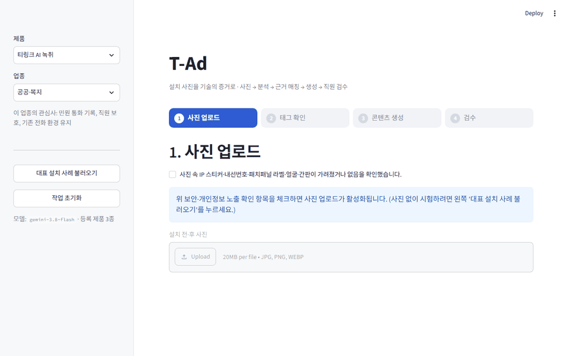

# T-Ad — 설치 사진을 기술의 증거로 바꾸는 AI 홍보 도구

> 설치 현장 사진을 티링크 기술의 증거로 바꿔, 회사가 승인한 제품 근거로만 업종별 홍보 콘텐츠를 만들고 근거 없는 수치는 코드로 걸러 냅니다.

AI 스마트워크톤 트랙 A · 티링크 과제 · 팀 프로젝트100 · [기획서](docs/T-Ad_기획서_v4.pdf) · [발표 자료](docs/slides.pdf) · [예상 질문](docs/qna.md)

<!-- TODO(문서 담당): 시연 GIF를 docs/demo.gif로 넣고 아래 주석을 푼다 -->
<!--  -->

## 문제

- 티링크의 강점(기존 전화기·회선 교체 불필요, 통신사 무관, 좁은 단자함에도 설치)은 **눈에 보이지 않는 기술**인데, 현장 사진은 단자함과 케이블뿐입니다.
- 설치 사례 갤러리는 대부분 업종 태그와 마스킹된 고객명만 있고, 어떤 문제를 어떤 기술로 풀었는지 설명이 없습니다.
- 학교, 콜센터, 건설 현장은 반응하는 메시지가 달라 같은 사진도 업종마다 글을 다시 써야 합니다.
- 생성형 AI로 쓰면 근거 없는 수치가 섞여 표시·광고 리스크가 생깁니다.

## Before / After

| | Before (사람) | After (T-Ad) |
|---|---|---|
| 사진 해석 | 담당자가 직접 | AI가 설치 형태·문제 태그 후보 제안 → 직원이 확인 |
| 제품 근거 찾기 | 홈페이지·자료를 매번 다시 찾음 | 승인된 제품 지식 베이스에서 자동 매칭 |
| 채널·업종별 작성 | 업종마다 다시 씀 | 업종만 바꾸면 메시지 재생성 |
| 수치 검증 | 사람 눈으로 | 코드가 모든 수치를 근거와 대조, 없는 수치는 빨간색 |

<!-- TODO(PM): 시연에서 잰 실제 시간으로 채운다. 추정치를 쓰지 않는다. -->

## 작동 방식

```
사진 업로드 → 사진 분석(Gemini) → 직원 태그 확인 → 근거 매칭 + 업종별 생성(Gemini) → 코드 팩트체크 → 직원 검수·내려받기
```

**코드 팩트체크 ([factcheck.py](factcheck.py))**: AI가 AI를 검사하지 않습니다. 생성된 글에서 단위가 붙은 수치를 정규식으로 뽑아 `3,000석`=`3000석`, `150만 원`=`1,500,000원`처럼 정규화한 뒤, 선택한 제품의 근거와 직원이 확인한 사진 설명에 있는 수치만 통과시킵니다. 금지 표현(최고·1위·100% 등)도 함께 표시합니다.

## 실행 방법

```bash
python3 -m venv .venv && source .venv/bin/activate
pip install -r requirements.txt
cp .streamlit/secrets.toml.example .streamlit/secrets.toml   # GEMINI_API_KEY 입력
streamlit run app.py
```

테스트: `python tests/test_factcheck.py`

## 폴더 구조

| 경로 | 내용 |
|---|---|
| `app.py` | Streamlit 화면 (업로드 → 태그 확인 → 생성 → 검수) |
| `llm.py` | Gemini 호출 |
| `prompts/` | 사진 분석·콘텐츠 생성 프롬프트 원문 |
| `factcheck.py` | 규칙 기반 수치·금지 표현 검증 |
| `data/knowledge_base.json` | 회사가 승인한 제품 근거 (출처 포함) |
| `tests/` | 팩트체크 테스트 |
| `docs/` | 기획서, 발표 자료, 시연 GIF |

## 확산 가능성

`data/knowledge_base.json`만 바꾸면 설치·시공 사진이 쌓이는 다른 B2B 기업(보안 장비, 냉난방, 태양광 등)에도 그대로 쓸 수 있습니다.

## 한계와 다음 단계

- 단위가 없는 주장("성능이 뛰어남")은 금지어 외에는 검출하지 못해, 게시 전 직원 검수가 필요합니다.
- 범용 비전 모델의 장비 인식 정확도는 검증되지 않아 반자동(AI 제안 → 직원 선택)으로 시작합니다.
- 다음 단계: OCR 자동 모자이크, 카드뉴스 이미지 렌더링, 잠재고객용 "우리 사무실에도 될까?" 진단 페이지.
- 지식 베이스 수치는 공개 홈페이지 기준이며 회사의 최종 승인이 필요합니다.

## 협업 방식: GitHub Flow

1. `main`은 항상 실행 가능한 상태로 둡니다. Streamlit Cloud는 `main`을 배포합니다.
2. 작업마다 `main`에서 브랜치를 만듭니다. 이름은 `종류/이슈번호-짧은설명` (예: `feat/8-reset-on-new-photo`, `fix/2-gemini-client`, `docs/11-slides`).
3. 작게 자주 커밋하고 push합니다. 커밋 메시지는 `feat:`, `fix:`, `docs:`, `test:`, `chore:`로 시작합니다.
4. Pull Request를 엽니다. 본문에 `closes #이슈번호`를 쓰면 머지할 때 이슈가 닫힙니다.
5. 팀원 1명이 확인하고 승인하면 머지합니다. 대회 중에는 리뷰를 5분 안에 끝냅니다.
6. 머지한 브랜치는 지우고, 다른 팀원은 `git pull`로 최신 `main`을 받습니다.

```bash
git switch main && git pull
git switch -c feat/8-reset-on-new-photo
git commit -am "feat: 사진을 바꾸면 분석 결과 초기화"
git push -u origin feat/8-reset-on-new-photo
gh pr create --fill --body "closes #8"
```

## 팀

팀 **프로젝트100**

| 이름 | GitHub | 역할 | 담당 |
|---|---|---|---|
| 안영진 | [MICcall2004](https://github.com/MICcall2004) | PM·발표 | 주최 측 확인, 시간 측정, 발표 자료, README |
| 이경민 | [YelPle](https://github.com/YelPle) | 앱·배포 | Streamlit 화면, 배포, Gemini 연동 |
| 이용준 | [yongtrol](https://github.com/yongtrol) | AI·프롬프트·지식 베이스 | 프롬프트, 사진 분석, 지식 베이스 검증 |
| 김민성 | [minstouch](https://github.com/minstouch) | 팩트체크·테스트·시연 | 코드 팩트체크, 테스트, 시연 녹화 |
